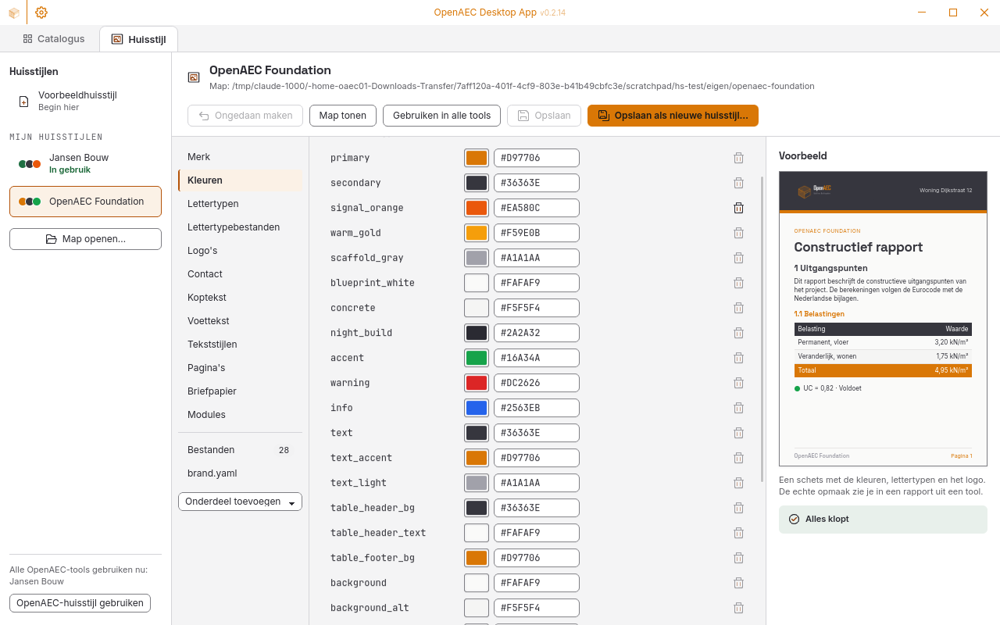

# De huisstijlmaker

In de tab **Huisstijl** van de OpenAEC Installer maak je de huisstijl van je bedrijf. Rapporten uit elke OpenAEC-tool
op de computer gebruiken hem daarna: kleuren, lettertypen, logo, kop- en voettekst en briefpapier.

## Zo werkt het

1. **Begin met de voorbeeldhuisstijl.** Die opent vanzelf: de huisstijl van OpenAEC onder de naam Voorbeeldbouw B.V.
   Een bestaande huisstijl open je links, of met **Map openen…** (een map met `brand.yaml`).
2. **Pas aan.** In het midden staan de onderdelen van `brand.yaml`: Merk, Kleuren, Lettertypen, Lettertypebestanden,
   Marges en wat er verder in staat. Elke regel kun je wijzigen, hernoemen en verwijderen, en je kunt regels en hele
   onderdelen toevoegen (Logo's, Contact, Koptekst, Voettekst, Tekststijlen, Briefpapier). Een kleur kies je met het
   kleurvlak of typ je als `#1F6F43`. Bij een logo, lettertype of briefpapier kies je een bestand; dat komt bij het
   opslaan in de map van de huisstijl. Onder **brand.yaml** bewerk je het hele bestand als tekst.
3. **Bekijk het voorbeeld.** Rechts staat een schets van een rapportpagina met je kleuren, lettertypen en logo, en
   daaronder wat nog niet klopt: een kleur die geen `#RRGGBB` is, een lettertype zonder bestand, een logo dat ontbreekt.
4. **Sla op als nieuwe huisstijl.** Vul de naam van het bedrijf in en kies waar: bij je eigen huisstijlen op deze
   computer, of in een andere map, bijvoorbeeld op de schijf van het bedrijf zodat collega's dezelfde map kiezen. Met
   het vinkje **Meteen gebruiken in alle OpenAEC-tools** staat hij direct aan.

Een opgeslagen huisstijl bewerk je daarna verder met **Opslaan**. **Ongedaan maken** gaat tot honderd stappen terug.
Links onderin staat welke huisstijl de tools nu gebruiken; **OpenAEC-huisstijl gebruiken** zet hem terug.

## Wat er op schijf komt

Een map met `brand.yaml` (het formaat van OpenAEC Reports) en de bestanden ernaast (`fonts/`, `logos/`,
`stationery/`, `templates/`). Eigen huisstijlen staan in `eigen/<naam>` onder de map van de huisstijlen:
`%LOCALAPPDATA%\OpenAEC\huisstijl`, `~/Library/Caches/OpenAEC/huisstijl` of `$XDG_CACHE_HOME/openaec/huisstijl`
(of `OPENAEC_HUISSTIJL_DIR`). Een bestaande map met een huisstijl wordt nooit overschreven door **Opslaan als nieuwe
huisstijl**; een tweede met dezelfde naam krijgt `-2`. De volgorde van `brand.yaml` blijft staan, commentaar niet.

De keuze voor alle tools staat in `actief.json` in dezelfde map, zoals beschreven in
[`docs/bedrijfshuisstijl.md`](https://github.com/OpenAEC-Foundation/OpenAEC-Blueprint/blob/main/docs/bedrijfshuisstijl.md)
van OpenAEC-Blueprint.

## In de code

| Wat | Waar |
|---|---|
| Lezen, controleren, opslaan, de voorbeeldhuisstijl | `crates/openaec-huisstijl` (module `maker`), overgenomen uit OpenAEC-Blueprint met `scripts/sync-openaec.mjs`; pas het daar aan |
| Tauri-commando's | `src-tauri/src/huisstijl.rs` |
| Aanroepen en bewerkingen op de boom | `src/lib/huisstijl.ts` (tests in `huisstijl.test.ts`) |
| Scherm | `src/components/huisstijl/`: `HuisstijlView`, `TreeEditor`, `Preview` |
| Teksten | `src/i18n/locales/{nl,en}/huisstijl.json` |

## Wat nog niet

- Het voorbeeld is een schets, geen PDF uit de rapportmotor.
- Een huisstijl uit de SuperCloud ophalen doe je in een tool (statusbalk, **Huisstijl**), niet hier.
- Bestanden uit de map verwijderen kan nog niet vanuit de app.
